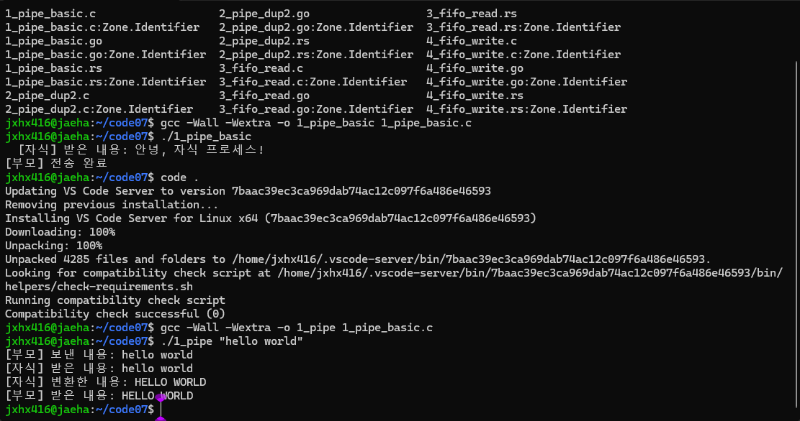
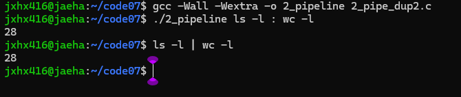
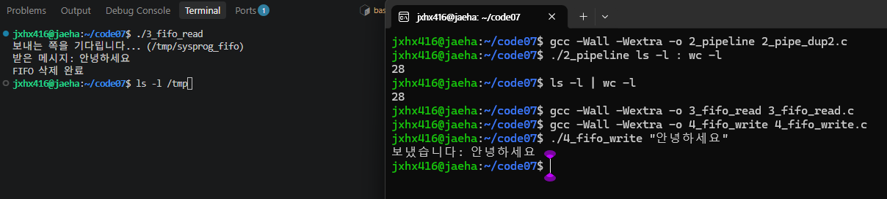

# 7주차 실습과제 — 파이프와 FIFO

## 1. 프로젝트 설명

시스템프로그래밍 7주차 실습으로, 리눅스 환경에서 파이프와 FIFO를 이용한 프로세스 간 통신(IPC)을 구현하였다.

총 3가지 과제를 수행하였다.

### 과제 1. 파이프를 이용한 부모-자식 왕복 통신
- 파일: `1_pipe_basic.c`
- 부모가 명령행 인자로 입력받은 문자열을 자식에게 전달한다.
- 자식은 문자열을 대문자로 변환하여 부모에게 돌려준다.
- 양방향 통신을 위해 파이프 2개를 사용하였다.

### 과제 2. dup2를 이용한 명령어 연결
- 파일: `2_pipe_dup2.c`
- `:`를 기준으로 두 명령어를 구분한다.
- `dup2()`로 첫 번째 명령어의 표준출력과 두 번째 명령어의 표준입력을 연결한다.
- `execvp()`를 사용하여 입력한 명령어를 실행한다.

### 과제 3. FIFO를 이용한 메시지 통신
- 파일: `3_fifo_read.c`, `4_fifo_write.c`
- FIFO를 이용해 서로 독립적인 두 프로세스 사이에서 메시지를 전달한다.
- 받는 프로그램을 먼저 실행하고 보내는 프로그램을 나중에 실행한다.
- 통신이 끝나면 `unlink()`로 FIFO를 삭제한다.

## 2. 컴파일 및 실행 방법

### 과제 1

```bash
gcc -Wall -Wextra -o 1_pipe 1_pipe_basic.c
./1_pipe "hello world"
```

### 과제 2

```bash
gcc -Wall -Wextra -o 2_pipeline 2_pipe_dup2.c
./2_pipeline ls -l : wc -l
```

### 과제 3

```bash
gcc -Wall -Wextra -o 3_fifo_read 3_fifo_read.c
gcc -Wall -Wextra -o 4_fifo_write 4_fifo_write.c
```

터미널 1:

```bash
./3_fifo_read
```

터미널 2:

```bash
./4_fifo_write "안녕하세요"
```

## 3. 실행 결과

### 과제 1. 부모-자식 왕복 통신



### 과제 2. dup2 명령어 연결



### 과제 3. FIFO 메시지 통신



## 4. 본인의 보강 및 확인 내용

- 기존 단방향 파이프 예제를 양방향 통신 방식으로 확장하였다.
- 명령행 인자를 입력받아 다양한 문자열을 처리하도록 변경하였다.
- `dup2()`와 `execvp()`를 이용하여 두 명령어를 연결하는 기능을 구현하였다.
- FIFO 예제에서는 기존 구조를 유지하면서 오류 검사 기능을 일부 보강하였다.
- VS Code에서 코드를 저장하지 않아 수정 전 프로그램이 실행되는 문제를 확인하고, 저장 후 재컴파일하여 해결하였다.
- Ubuntu 터미널 두 개에서 FIFO 메시지 송수신 및 삭제 결과를 확인하였다.